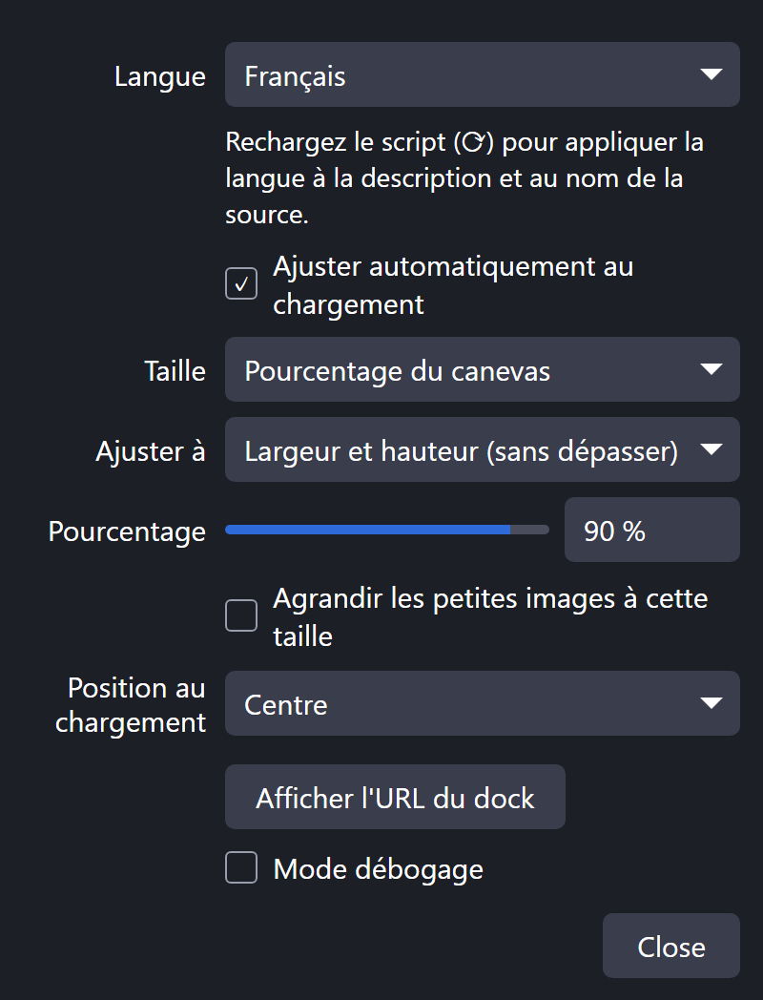
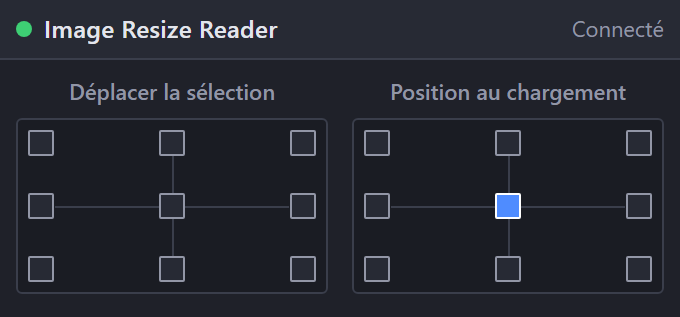

[English](README.md) | [日本語](README.ja.md) | [한국어](README.ko.md) | [Bahasa Indonesia](README.id.md) | **Français** | [繁體中文](README.zh-TW.md)

# Image Resize Reader for OBS

Un script Lua pour OBS Studio (Windows) qui ajuste images et vidéos au canevas dès leur ajout, pour qu'une grande image ne sorte jamais de l'écran.

 

- Taille : 1–100 % du canevas, taille en pixels ou taille d'origine. Ajustement en largeur, en hauteur ou les deux (sans dépasser)
- Agrandissement optionnel des petites images à la taille choisie
- Position au chargement : neuf points au choix
- Dock à neuf boutons : déplace l'élément sélectionné (ou le dernier placé) au bord du canevas, sans sortir de l'écran. Les éléments pivotés, recadrés ou délimités sont pris en charge
- Chaque bouton est aussi un raccourci (Paramètres → Raccourcis)
- Interface : English / 日本語 / 한국어 / Bahasa Indonesia / Français / 繁體中文 (autres langues d'OBS → English)

Les éléments déjà présents dans une scène et les sources ajoutées de nouveau depuis une autre scène ne sont pas modifiés.

## Fichiers pris en charge

| Fichiers | Comment les ajouter |
|---|---|
| `.bmp .tga .png .jpg .jpeg .jxr .gif .psd .webp` | Glisser-déposer, ou Sources → + |
| `.mp4 .m4v .mov .mkv .webm .avi .flv .ts .m2ts .mts .mpg .mpeg .wmv` | Glisser-déposer, ou Sources → + |

## Installation
1. Gardez `obs_image_resize_reader.lua` et `obs_image_resize_reader_dock.html` dans le même dossier.
2. OBS → **Outils → Scripts → +** → sélectionnez `obs_image_resize_reader.lua`.
3. Cliquez sur **Afficher l'URL du dock**, copiez l'**URL du dock**, puis **Docks → Docks de navigateur personnalisés…** → collez-la.
4. Activez **Outils → Paramètres du serveur WebSocket** et saisissez le même port / mot de passe dans les réglages du script.

## Désinstallation
Retirez le script dans **Outils → Scripts** (sélection, puis **−**), fermez OBS, puis lancez `Safe_Uninstaller.bat`. Il indique le rôle de chaque fichier, vous laisse choisir quoi supprimer, sauvegarde vos réglages, explique le passage à un autre PC et envoie le tout à la Corbeille.

Nécessite OBS 28+ (obs-websocket v5 intégré) sous Windows.

Auteur : ChromeBread feat. BlackDream ・ Licence : GPL-2.0

Ce script tiers n'est pas officiel. Il n'est ni affilié au projet OBS ni approuvé par celui-ci.

## Mises à jour

Ce logiciel ne vérifie pas les mises à jour et ne se met pas à jour tout seul, et aucune fonction de mise à jour automatique connectée à Internet n'est prévue. Pour mettre à jour, suivez le lien du développeur et téléchargez vous-même la nouvelle version sur le site de distribution : [Releases](../../releases)
