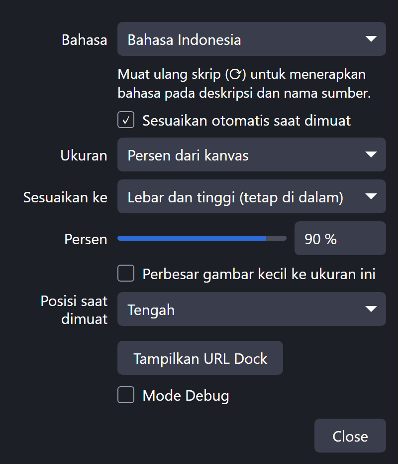
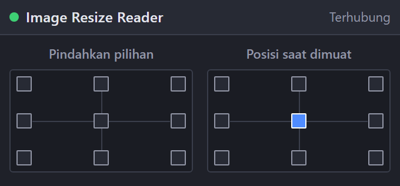

[English](README.md) | [日本語](README.ja.md) | [한국어](README.ko.md) | **Bahasa Indonesia** | [Français](README.fr.md) | [繁體中文](README.zh-TW.md)

# Image Resize Reader for OBS

Skrip Lua untuk OBS Studio (Windows) yang menyesuaikan gambar dan video ke kanvas saat ditambahkan, sehingga gambar besar tidak keluar dari layar.

 

- Ukuran: 1–100 % kanvas, ukuran piksel, atau ukuran asli. Sesuaikan ke lebar, tinggi, atau keduanya (tetap di dalam)
- Gambar kecil dapat diperbesar ke ukuran yang dipilih
- Posisi saat dimuat: salah satu dari sembilan titik
- Dock dengan tombol sembilan titik: memindahkan item terpilih (atau yang terakhir ditempatkan) ke tepi kanvas tanpa keluar layar. Item yang diputar, dipotong, atau berbatas juga didukung
- Setiap tombol juga tersedia sebagai hotkey (Pengaturan → Hotkey)
- UI: English / 日本語 / 한국어 / Bahasa Indonesia / Français / 繁體中文 (bahasa OBS lain → English)

Item yang sudah ada di adegan dan sumber yang ditambahkan lagi dari adegan lain tidak diubah.

## File yang didukung

| File | Cara menambahkan |
|---|---|
| `.bmp .tga .png .jpg .jpeg .jxr .gif .psd .webp` | Seret & lepas, atau Sumber → + |
| `.mp4 .m4v .mov .mkv .webm .avi .flv .ts .m2ts .mts .mpg .mpeg .wmv` | Seret & lepas, atau Sumber → + |

## Instalasi
1. Simpan `obs_image_resize_reader.lua` dan `obs_image_resize_reader_dock.html` di folder yang sama.
2. OBS → **Alat → Skrip → +** → pilih `obs_image_resize_reader.lua`.
3. Tekan **Tampilkan URL Dock**, salin **URL Dock**, lalu **Dock → Dock Peramban Kustom…** → tempel.
4. Aktifkan **Alat → Pengaturan Server WebSocket** dan masukkan port / kata sandi yang sama di pengaturan skrip.

## Hapus instalasi
Hapus skrip dari **Alat → Skrip** (pilih, tekan **−**), tutup OBS, lalu jalankan `Safe_Uninstaller.bat`. Alat ini menampilkan fungsi tiap file, memungkinkan Anda memilih yang dihapus, mencadangkan pengaturan, menjelaskan cara pindah ke PC lain, dan memindahkan semuanya ke Recycle Bin.

Memerlukan OBS 28+ (obs-websocket v5 bawaan) di Windows.

Pembuat: ChromeBread feat. BlackDream ・ Lisensi: GPL-2.0

Ini adalah skrip pihak ketiga tidak resmi. Tidak berafiliasi dengan atau didukung oleh OBS Project.

## Tentang pembaruan

Perangkat lunak ini tidak memeriksa pembaruan atau memperbarui dirinya sendiri, dan tidak ada rencana menambahkan fitur pembaruan otomatis yang terhubung ke internet. Untuk memperbarui, ikuti tautan pengembang dan unduh versi baru sendiri dari situs distribusi: [Releases](../../releases)
