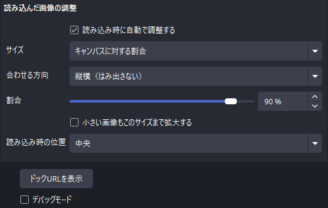
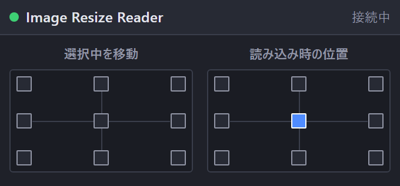

[English](README.md) | **日本語** | [한국어](README.ko.md) | [Bahasa Indonesia](README.id.md) | [Français](README.fr.md) | [繁體中文](README.zh-TW.md)

# Image Resize Reader for OBS

画像や動画を追加した瞬間にキャンバスへ収め、大きな画像が画面からはみ出すのを防ぐ OBS Studio (Windows) Lua スクリプトです。

 

- サイズ: キャンバスの 1〜100 %、ピクセル指定、元のサイズ。幅、高さ、または両方 (はみ出さない) に合わせられます
- 小さい画像を指定サイズまで拡大することもできます
- 読み込み時の位置: 9 か所から選べます
- 9 点ボタンのドック: 選択中のアイテム (または最後に配置したアイテム) を、はみ出さないようにキャンバスの端へ寄せます。回転、クロップ、領域指定されたアイテムにも対応します
- 各ボタンはホットキーにも割り当てられます (設定 → ホットキー)
- UI は English / 日本語 / 한국어 / Bahasa Indonesia / Français / 繁體中文 (他の OBS 言語は英語)

シーンに既にあるアイテムや、別のシーンから追加し直したソースは変更しません。

## 対応ファイル

| ファイル | 追加方法 |
|---|---|
| `.bmp .tga .png .jpg .jpeg .jxr .gif .psd .webp` | ドラッグ＆ドロップ、またはソース → + |
| `.mp4 .m4v .mov .mkv .webm .avi .flv .ts .m2ts .mts .mpg .mpeg .wmv` | ドラッグ＆ドロップ、またはソース → + |

## インストール
1. `Image_Resize_Reader_for_OBS` フォルダを丸ごと `%APPDATA%\obs-studio\plugin_config\` に置きます (このパスをエクスプローラーのアドレス欄に貼り付けると開けます)。
2. OBS → **ツール → スクリプト → +** で `obs_image_resize_reader.lua` を選びます。
3. **ドックURLを表示** を押して **ドックURL** をコピーし、**ドック → カスタムブラウザドック…** に貼り付けます。
4. **ツール → WebSocketサーバー設定** を有効にし、同じポートとパスワードをスクリプトの設定に入力します。

## アンインストール
**ツール → スクリプト** でスクリプトを外し (選択して **−**)、OBS を閉じてから `Safe_Uninstaller.bat` を実行します。各ファイルの内容を表示し、削除するものを選べます。設定のバックアップ、別の PC への引っ越し手順の表示にも対応し、削除したものはごみ箱へ移動します。

Windows の OBS 28 以降 (obs-websocket v5 内蔵) が必要です。

製作者: ChromeBread feat. BlackDream ・ ライセンス: GPL-2.0

これは非公式のサードパーティ製スクリプトです。OBS Project とは関係がなく、承認も受けていません。

## アップデートについて

本ソフトにはアップデートの確認機能や自動更新機能はなく、今後も通信を伴う自動アップデート機能を実装する予定はありません。アップデートの際は、開発者のリンクを辿ってご自身で配布サイトからダウンロードしてください: [Releases](../../releases)
