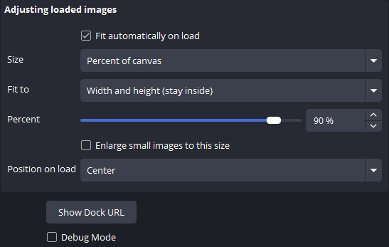
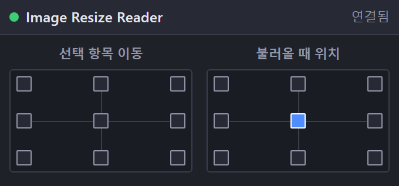

[English](README.md) | [日本語](README.ja.md) | **한국어** | [Bahasa Indonesia](README.id.md) | [Français](README.fr.md) | [繁體中文](README.zh-TW.md)

# Image Resize Reader for OBS

이미지와 영상을 추가하는 순간 캔버스에 맞춰, 큰 그림이 화면 밖으로 나가지 않게 하는 OBS Studio (Windows) Lua 스크립트입니다.

 

- 크기: 캔버스의 1–100 %, 픽셀 크기 또는 원본 크기. 너비, 높이 또는 둘 다 (넘치지 않게) 맞출 수 있습니다
- 작은 이미지를 지정한 크기까지 확대할 수도 있습니다
- 불러올 때의 위치: 9곳 중 선택
- 9점 버튼 도크: 선택한 항목 (또는 마지막으로 배치한 항목)을 화면 밖으로 나가지 않게 캔버스 가장자리에 붙입니다. 회전, 자르기, 영역 지정 항목도 지원합니다
- 각 버튼은 단축키로도 사용할 수 있습니다 (설정 → 단축키)
- UI: English / 日本語 / 한국어 / Bahasa Indonesia / Français / 繁體中文 (다른 OBS 언어는 영어)

장면에 이미 있는 항목이나 다른 장면에서 다시 추가한 소스는 변경하지 않습니다.

## 지원 파일

| 파일 | 추가 방법 |
|---|---|
| `.bmp .tga .png .jpg .jpeg .jxr .gif .psd .webp` | 드래그 앤 드롭 또는 소스 → + |
| `.mp4 .m4v .mov .mkv .webm .avi .flv .ts .m2ts .mts .mpg .mpeg .wmv` | 드래그 앤 드롭 또는 소스 → + |

## 설치
1. `Image_Resize_Reader_for_OBS` 폴더를 통째로 `%APPDATA%\obs-studio\plugin_config\`에 넣습니다 (이 경로를 탐색기 주소창에 붙여넣으면 열립니다).
2. OBS → **도구 → 스크립트 → +** 에서 `obs_image_resize_reader.lua`를 선택합니다.
3. **도크 URL 표시**를 누르고 **도크 URL**을 복사해 **도크 → 사용자 지정 브라우저 도크…** 에 붙여넣습니다.
4. **도구 → WebSocket 서버 설정**을 켜고 같은 포트와 비밀번호를 스크립트 설정에 입력합니다.

## 제거
**도구 → 스크립트**에서 스크립트를 뺀 뒤 (선택하고 **−**) OBS를 닫고 `Safe_Uninstaller.bat`을 실행합니다. 각 파일의 내용을 보여 주고 제거할 항목을 고를 수 있습니다. 설정 백업과 다른 PC로 옮기는 방법도 제공하며, 제거한 항목은 휴지통으로 이동합니다.

Windows용 OBS 28 이상 (obs-websocket v5 내장)이 필요합니다.

제작자: ChromeBread feat. BlackDream ・ 라이선스: GPL-2.0

비공식 서드파티 스크립트입니다. OBS Project와 관련이 없으며 승인을 받지 않았습니다.

## 업데이트 안내

이 소프트웨어에는 업데이트 확인이나 자동 업데이트 기능이 없으며, 앞으로도 인터넷에 연결하는 자동 업데이트 기능을 구현할 계획이 없습니다. 업데이트할 때는 개발자의 링크를 따라 배포 사이트에서 직접 내려받으세요: [Releases](../../releases)
