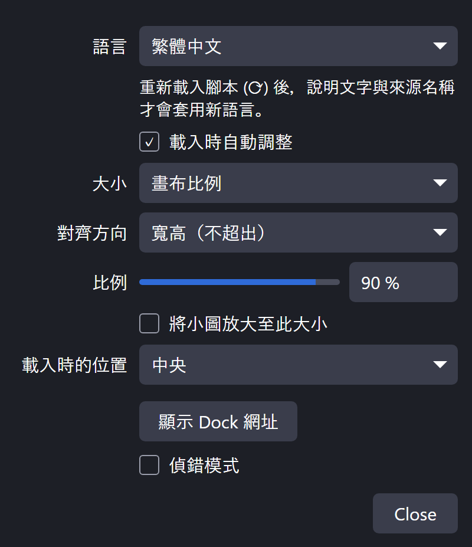
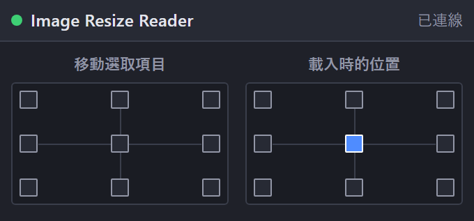

[English](README.md) | [日本語](README.ja.md) | [한국어](README.ko.md) | [Bahasa Indonesia](README.id.md) | [Français](README.fr.md) | **繁體中文**

# Image Resize Reader for OBS

OBS Studio (Windows) Lua 腳本，在新增圖片與影片的瞬間就將其調整至畫布內，避免大圖超出畫面。

 

- 大小：畫布的 1–100 %、像素大小或原始大小。可依寬度、高度或兩者 (不超出) 調整
- 可選擇將小圖放大到指定大小
- 載入時的位置：九個位置可選
- 九點按鈕停駐視窗：將選取項目 (或最後放置的項目) 移到畫布邊緣且不超出畫面，也支援旋轉、裁切與設定範圍的項目
- 每個按鈕也可設為快速鍵 (設定 → 快速鍵)
- 介面語言：English / 日本語 / 한국어 / Bahasa Indonesia / Français / 繁體中文 (其他 OBS 語言 → English)

場景中已有的項目，以及從其他場景重新加入的來源不會被變更。

## 支援的檔案

| 檔案 | 新增方式 |
|---|---|
| `.bmp .tga .png .jpg .jpeg .jxr .gif .psd .webp` | 拖放，或 來源 → + |
| `.mp4 .m4v .mov .mkv .webm .avi .flv .ts .m2ts .mts .mpg .mpeg .wmv` | 拖放，或 來源 → + |

## 安裝
1. 將 `obs_image_resize_reader.lua` 與 `obs_image_resize_reader_dock.html` 放在同一資料夾。
2. OBS → **工具 → 腳本 → +** → 選擇 `obs_image_resize_reader.lua`。
3. 按 **顯示 Dock 網址**，複製 **Dock 網址**，然後在 **停駐視窗 → 自訂瀏覽器停駐視窗…** 貼上。
4. 啟用 **工具 → WebSocket 伺服器設定**，並在腳本設定中輸入相同的連接埠與密碼。

## 解除安裝
在 **工具 → 腳本** 移除腳本 (選取後按 **−**)，關閉 OBS，再執行 `Safe_Uninstaller.bat`。它會顯示每個檔案的用途，可選擇要移除的項目、備份設定、說明如何搬移到其他電腦，並將項目移到資源回收筒。

需要 Windows 版 OBS 28 以上 (內建 obs-websocket v5)。

製作者: ChromeBread feat. BlackDream ・ 授權: GPL-2.0

這是非官方的第三方腳本，與 OBS Project 無關，也未獲其認可。

## 關於更新

本軟體沒有檢查更新或自動更新的功能，今後也沒有實作連網自動更新功能的計畫。需要更新時，請依開發者的連結自行前往發布網站下載: [Releases](../../releases)
